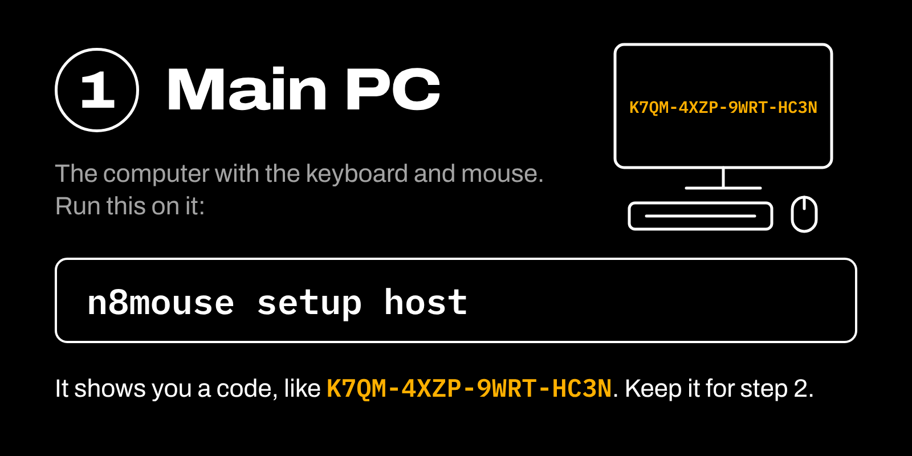
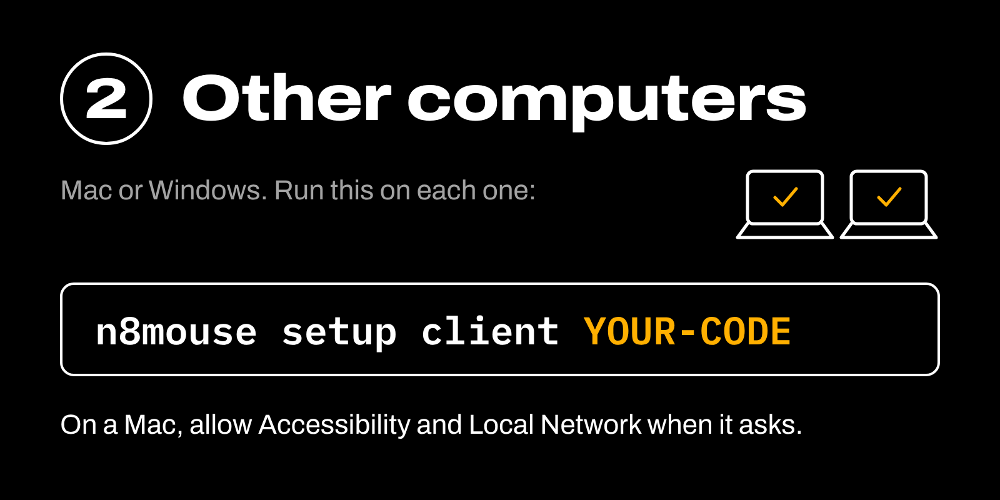
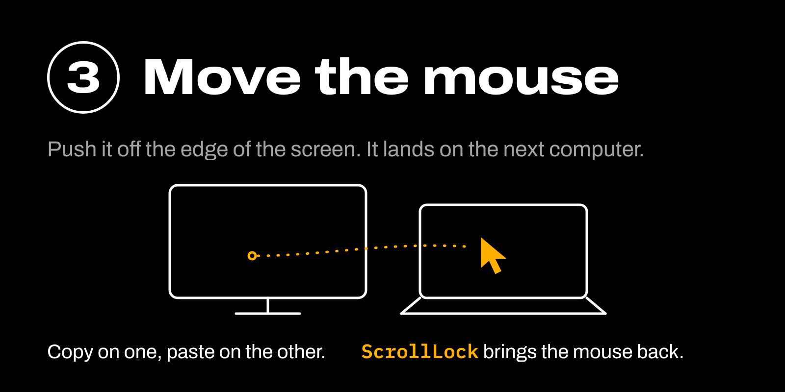

# n8Mouse+

One keyboard and mouse for every computer on your desk. Copy on one, paste on any.
Free and open source (MIT). No accounts, no licence server, no cloud.

## Install - 3 steps

Download the zip for each computer from the
[latest release](https://github.com/ctoxyz/n8mouse/releases/latest):

- Windows: `n8mouse-windows-x64.zip`
- Mac (Apple Silicon): `n8mouse-macos-arm64.zip`

On the Windows PC that has the keyboard and mouse:

1. Unzip to a folder you will keep, inside your own user folder, like `C:\Users\you\n8mouse`.
2. Right-click inside that folder and choose **Open in Terminal**.
3. Run:

       .\n8mouse setup host

4. Click **Yes** when Windows asks. It shows your pairing code.

**Windows:** unzip, open a terminal in the folder the same way, and run:

    .\n8mouse setup client YOUR-CODE

**Mac:** unzip, drag `n8mouse` into Applications, then run in Terminal:

    xattr -dr com.apple.quarantine /Applications/n8mouse.app
    /Applications/n8mouse.app/Contents/MacOS/n8mouse setup client YOUR-CODE

The first line is needed because the app is not signed yet.
When macOS asks, allow **Accessibility** and **Local Network**.

That's it. Everything starts at login from now on.

The main PC is found automatically. If your network blocks that, add its IP address
at the end: `setup client YOUR-CODE 192.168.1.10`

The downloads are not code-signed yet, so Windows or macOS may show a warning the first time.

## Use

- Push the pointer off a screen edge to move to the next computer.
- Computers line up left to right in the order they connect.
- **ScrollLock** on the host keyboard: back to the host.
- **Ctrl+Alt+1..9**: jump straight to screen N.
- Copy on any computer, paste on any other (text).

## Commands

| Command | |
|---|---|
| `n8mouse setup host` | Once, on the keyboard/mouse PC |
| `n8mouse setup client <CODE> [ip]` | Once, on every other computer |
| `n8mouse stop` | Stop until next login |
| `n8mouse uninstall` | Remove start-at-login and firewall rules |
| `n8mouse` | Run now in the role chosen at setup |

From the zip, type `.\n8mouse` (Windows) or
`/Applications/n8mouse.app/Contents/MacOS/n8mouse` (Mac) in place of `n8mouse`.

## Custom layout

Edit `"layout"` in the host's `n8mouse.json` (path shown by setup). Names are computer
names, not case sensitive; the reverse side is filled in for you.

    "layout": {
      "DESKTOP":  { "right": "macbook", "top": "laptop2" },
      "macbook": { "right": "laptop1" }
    }

## Security

- Every connection is encrypted with TLS 1.3, keyed from the pairing code.
- Both sides prove they hold the code during the handshake; the code itself never crosses the network.
  A device that does not have it cannot connect, cannot read traffic, and cannot pose as the host.
- 16-character pairing codes (~80 bits), stretched with scrypt.
- Repeated wrong codes from one address are blocked for a minute.
- The pairing code is stored only in your user settings file (owner-only on macOS).
- Every paired computer is fully trusted. It can type and click on the others, and it
  receives everything you copy, passwords included. Only pair computers you own.
- Anyone holding the pairing code can do the same, so treat it like a password. To change it,
  delete `n8mouse.json` on the host, run `n8mouse setup host`, and re-pair each computer.

Found a security problem? See [SECURITY.md](SECURITY.md).

## Limits

- Clipboard is text only.
- Each computer counts as one screen, however many monitors it has.
- The host must be Windows for now.
- The Mac download is for Apple Silicon.
- Made for a home or office network you trust, not public Wi-Fi.

Logs: `n8mouse.log` next to `n8mouse.json`.

## Run from source

Needs Python 3.13 or newer.

Windows:

    py -m pip install pynput pyperclip
    py n8mouse.py setup host

Mac:

    brew install python@3.13
    python3.13 -m venv .venv
    .venv/bin/pip install pynput pyperclip
    .venv/bin/python n8mouse.py setup client YOUR-CODE

On a Mac the permission prompts will name Python.
